# SmartMenuKJ

A free smart home app for phones and computers. Draw your home as a floor plan, put your devices where they really are, and control them with a tap. It is styled after Nothing OS: black and white, dot-matrix type and a single red accent.

Everything is free and local-first. There is no account, no cloud, no subscription and no paywall. The app talks to your devices directly on your home network, and your home layout is saved on your own device.

**[Download for Android](https://github.com/SW1TF0/HomeOS/releases/latest/download/SmartMenuKJ-android.apk)** · [Windows, macOS and Linux](https://github.com/SW1TF0/HomeOS/releases/latest)

| Home | A room | Light controls | Thermostat |
| --- | --- | --- | --- |
| 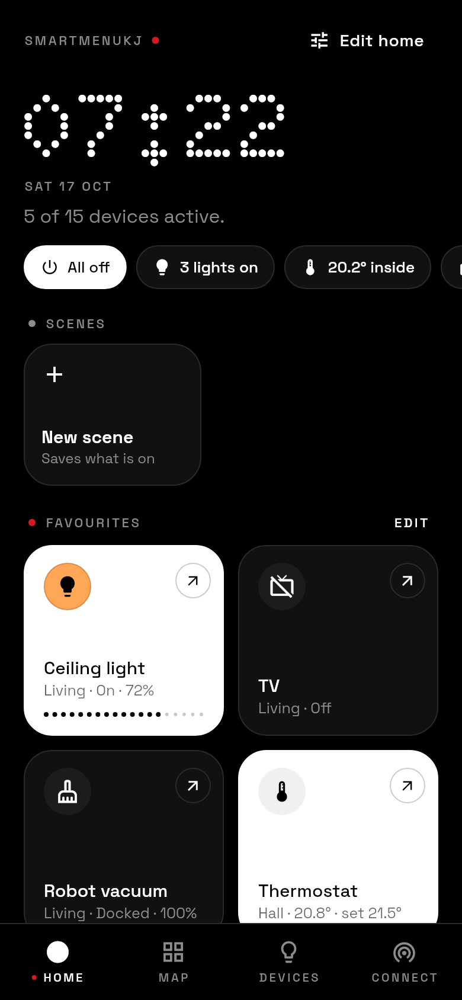 | 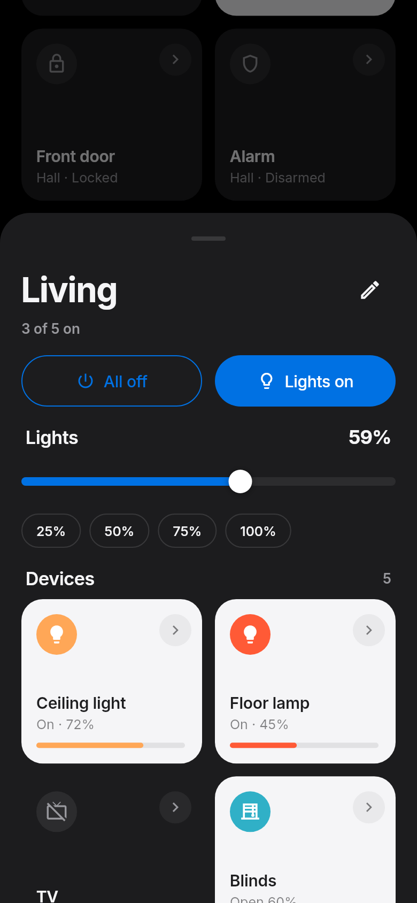 | 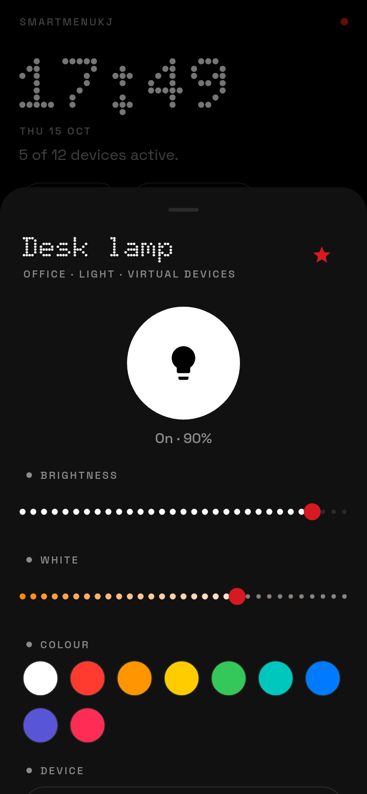 | 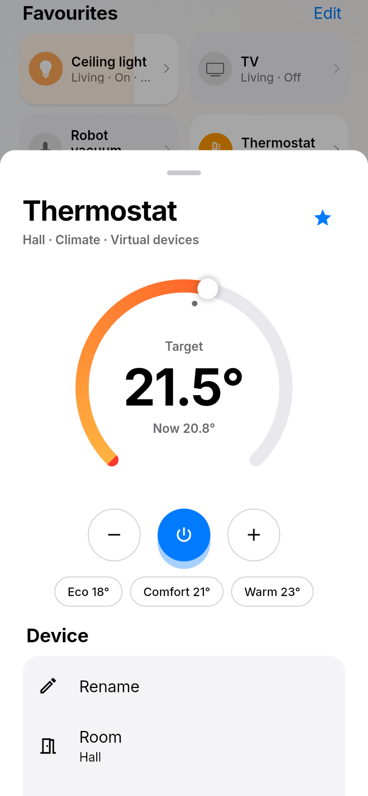 |

| Floor plan | Editing the plan | Drawing a room | Editing the home screen |
| --- | --- | --- | --- |
| 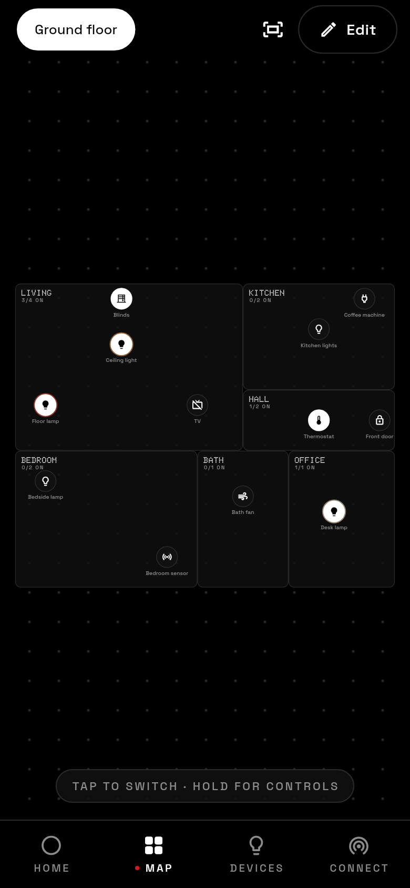 | 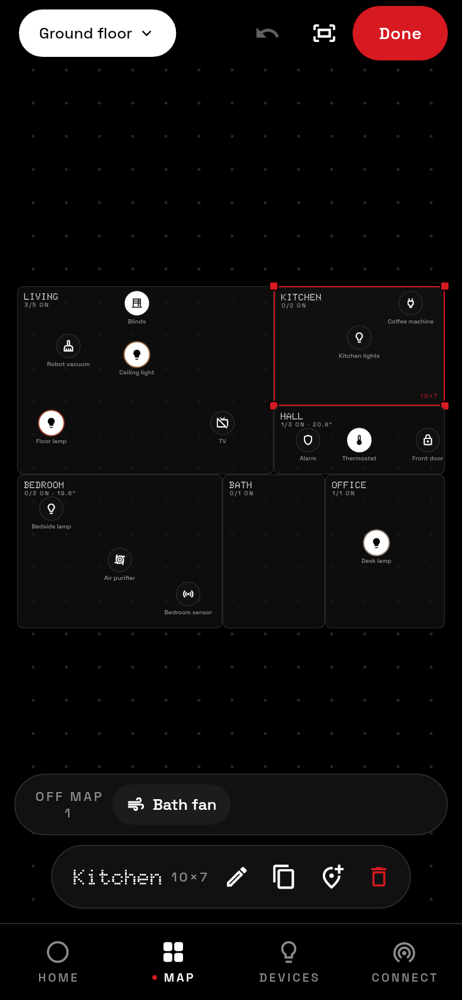 | 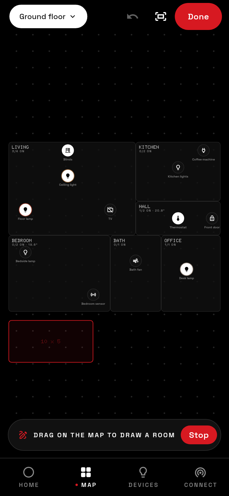 | 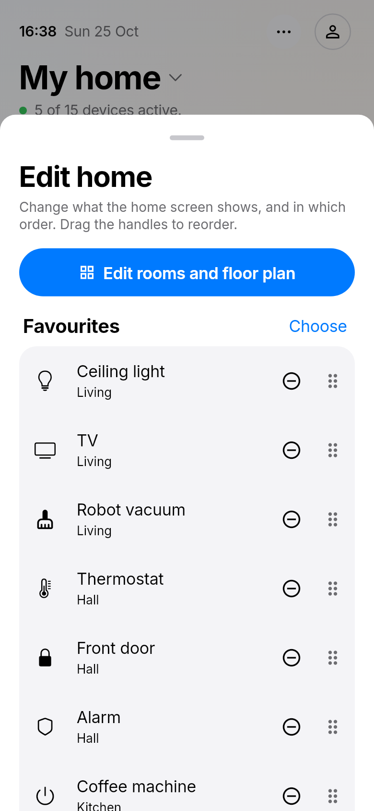 |

| Colour | Connections | Adding a Matter device | Light theme |
| --- | --- | --- | --- |
| 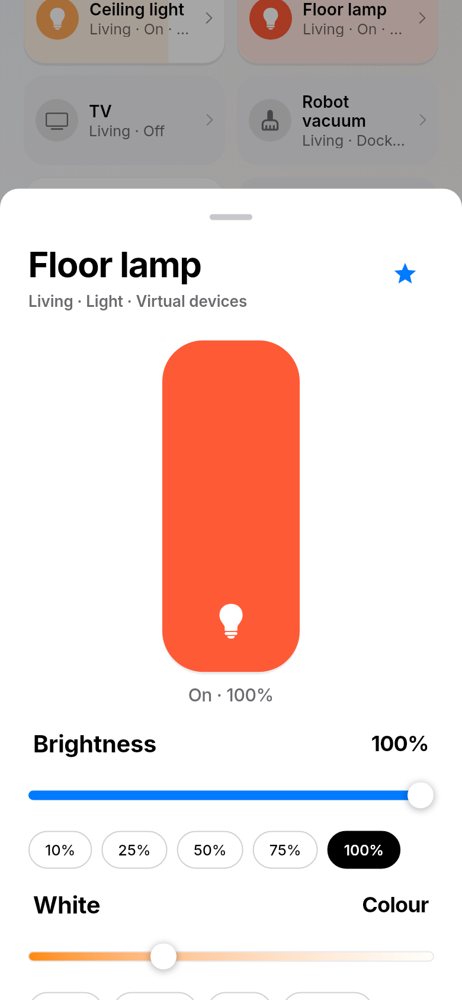 | 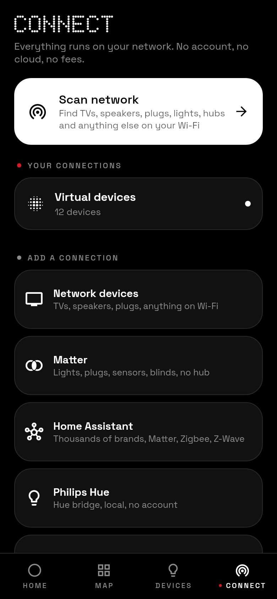 | 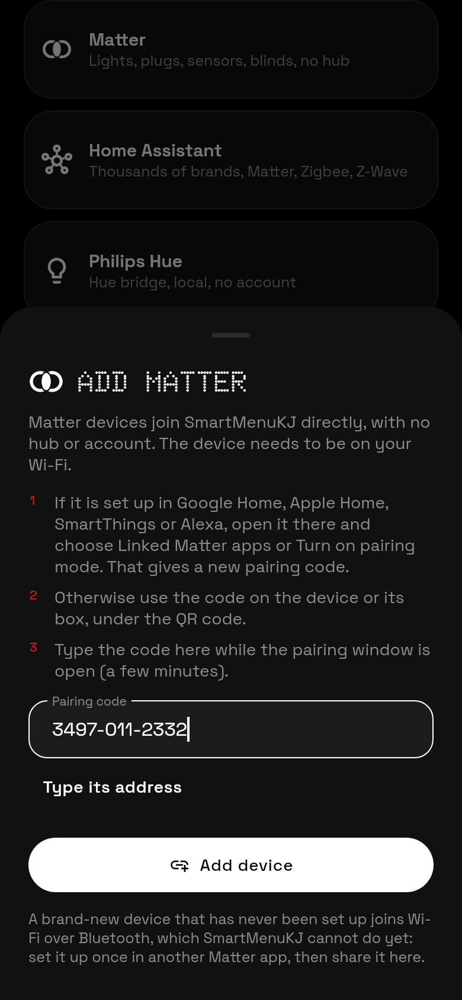 | 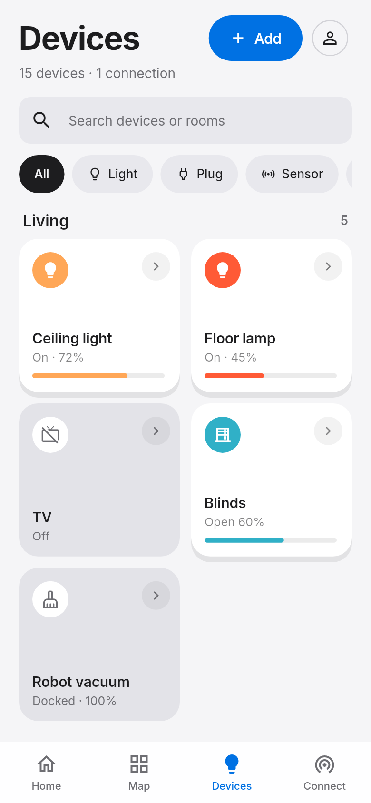 |

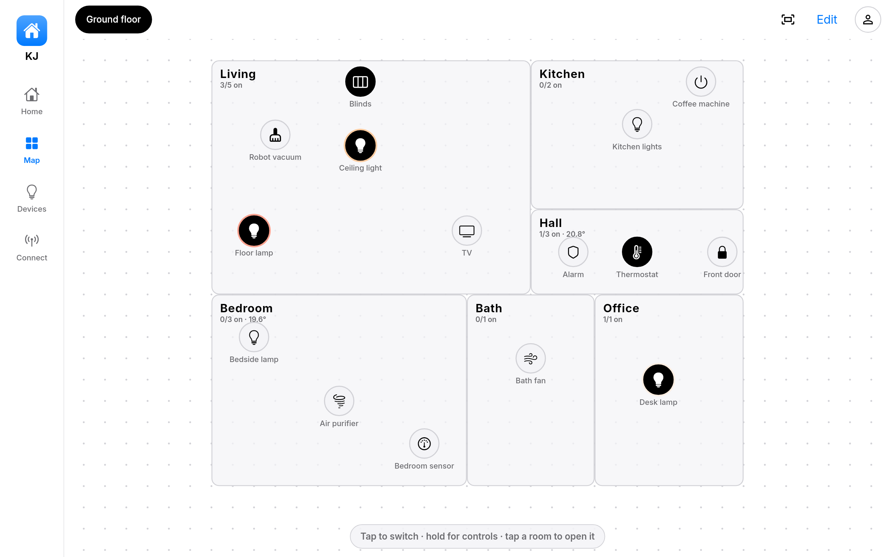

## What it does

- **Floor plan.** Add a ready-made room (Kitchen, Bedroom, Garage...) and it drops into a free spot, or draw one by dragging on the dotted grid. Move rooms, resize them from any corner, duplicate or delete them, and undo any change. Devices that are not on the plan wait in a tray at the bottom: drag one into a room and it joins that room. Tap a device on the plan to switch it, hold it for full controls, tap a room to open it.
- **Controls.** Dot-matrix sliders with one-tap presets for brightness and white (Warm, Neutral, Cool, Daylight), a colour ring, a thermostat dial with Eco / Comfort / Warm, blinds you slide open, volume, locks that only open when you hold them, and sensor readings, each shown only when the device supports it. Drag sideways across a light's tile to dim it without opening anything.
- **Home screen.** A dot-matrix clock and a status strip (lights on, temperature inside, locks, open blinds, offline devices) where each pill opens the devices behind it, next to one button that switches everything off. Then your favourites and your rooms. **Edit home** picks and orders the favourites and rooms.
- **Rooms.** Tap a room on the home screen or the plan to see everything in it: one slider for all its lights, all off / lights on, every device, and a shortcut to edit the room on the plan.
- **Scenes.** Set your devices the way you like, save it as a scene ("Movie night", "Good night"...), and bring it back with one tap. Scenes can run by themselves at a time of day on chosen weekdays. On Android they run even when the app is closed (an exact alarm wakes it); on computers they run while the app is open.
- **Matter, with no hub.** SmartMenuKJ is its own Matter controller: type a device's pairing code and its lights, plugs, sensors, blinds, locks or thermostat appear, controlled directly on your network. Matter bridges (Hue, IKEA, Aqara...) bring all their devices at once.
- **Scan network.** Finds everything on your Wi-Fi that answers (mDNS, UPnP / SSDP, Kasa and Yeelight discovery, and a quick check of TV ports): TVs, speakers, plugs, lights, hubs, printers and more. Add anything in one tap, or type a device's IP address.
- **TV remote.** Power, volume, mute, channels, arrows, OK, back, home and play / pause for Samsung, LG, Sony and Roku TVs, plus volume and play / pause for Chromecast, Google TV and UPnP speakers. TVs that are fully off are woken with Wake-on-LAN.
- **Backups.** Copy your whole home (rooms, devices, connections) as text and paste it back on another phone or computer.
- **Light and dark themes**, phone layout with a bottom bar, desktop layout with a side rail.

## Which devices work

No app can speak every protocol on its own, so SmartMenuKJ combines direct local control of the most common open systems with bridges that already cover thousands of brands.

| Connection | What it reaches | How |
| --- | --- | --- |
| **Matter** | Matter lights, plugs, switches, sensors, blinds, thermostats and locks, and everything behind a Matter bridge (Hue, IKEA, Aqara, SwitchBot...) | SmartMenuKJ is its own Matter controller: add a device with its pairing code and it is controlled directly on your network. No hub, cloud or account |
| **Home Assistant** | Anything Home Assistant supports: Matter and Thread, Zigbee (ZHA), Z-Wave, Google Nest, Sonos, IKEA, Xiaomi, Tuya, TP-Link, thermostats, locks, media players and more | Its REST API with a long-lived access token |
| **MQTT & Zigbee2MQTT** | Over 4,000 Zigbee devices through Zigbee2MQTT, plus anything that uses Home Assistant MQTT discovery (Tasmota, ESPHome, Shelly, OpenMQTTGateway...), plus any device you describe by topic | Any MQTT broker, live updates |
| **Network devices** | Samsung (Tizen), LG (webOS), Sony Bravia and Roku TVs; Chromecast, Google TV and Nest speakers; UPnP / DLNA TVs, speakers and receivers (Sonos and others); TP-Link Kasa plugs, strips and bulbs; Yeelight; Belkin WeMo. Anything else shows as online / offline and can be woken with Wake-on-LAN | Each device's own local protocol. Samsung and LG TVs ask once on screen to allow the app; Sony TVs need a pre-shared key set under IP control |
| **Philips Hue** | Hue lights and plugs | The bridge's local API. Press the link button, tap Pair |
| **Shelly** | Gen1, Plus, Pro, Gen3 and Gen4 relays, plugs, dimmers, shutters and H&T sensors | Local HTTP / RPC |
| **Tasmota** | Plugs, bulbs, switches and sensors with Tasmota firmware | Local HTTP commands |
| **WLED** | LED strips and lamps | Local JSON API |
| **ESPHome** | Lights, switches, fans, covers, locks and sensors | The `web_server:` component |
| **Virtual devices** | Placeholders for trying the app or planning before you buy | Built in |

**Matter:** the device has to be on your network already. If it is set up in Google Home, Apple Home, SmartThings or Alexa, open it there and choose *Linked Matter apps* (or *Turn on pairing mode*) to get a new pairing code, then type it in **Connect → Matter** or **Devices → Add device**. It stays in the other app too. Brand-new devices that join Wi-Fi over Bluetooth need to be set up once in another Matter app first; SmartMenuKJ cannot do Bluetooth setup yet.

New device families are added by writing one driver class in `lib/integrations/` and listing it in `lib/integrations/catalog.dart`.

## Getting the app

Builds are made for free by GitHub Actions (`.github/workflows/build.yml`):

- Every push to `main` builds an Android APK, a Windows zip, a Linux tarball and a macOS app, attached to the workflow run under **Artifacts**.
- Pushing a tag such as `v1.0.0` also publishes them on the **Releases** page.

The macOS app is not signed, so the first time you open it, right-click it and choose Open. iPhone builds need an Apple developer account to sign, so for now build them yourself with Xcode (`flutter build ios`).

### Build it yourself

1. Install [Flutter](https://docs.flutter.dev/get-started/install) (stable channel).
2. `flutter pub get`
3. Run it: `flutter run` (pick a phone, emulator, or `-d windows` / `-d macos` / `-d linux`).

## First steps in the app

1. The app opens with a sample home of virtual devices so you can try everything right away. Delete or move anything you like.
2. Go to **Connect** and tap **Scan network**, or pick a connection and type its address.
3. New devices appear on the **Devices** tab. Open **Map** and tap **Edit**: new devices wait in the tray at the bottom, drag each one into its room.

## For developers

```
lib/
  models/         Device, room, floor and home data (JSON)
  integrations/   One driver per system + catalog + network scan
  state/          HomeStore (all changes go through it), local storage, sample home
  theme/          Nothing-style colours and type
  ui/             Screens and shared widgets
test/             Model, driver, store and widget tests
tool/             Screenshot generator
```

- `flutter analyze` and `flutter test` run on every pull request.
- `flutter test tool/screenshots_test.dart --update-goldens` regenerates the screenshots in `docs/screenshots/`.

## Credits and licences

- App code: MIT licence, see `LICENSE`.
- [Doto](https://fonts.google.com/specimen/Doto) and [Space Grotesk](https://fonts.google.com/specimen/Space+Grotesk) fonts: SIL Open Font License, see `assets/fonts/`.
- SmartMenuKJ is an independent project. It is inspired by Nothing's design language and is not affiliated with or endorsed by Nothing Technology, Philips Hue, Shelly or any other brand named here.
