# SmartHomeKJ


A free smart home app for phones and computers. Draw your home as a floor plan, put your devices where they really are, and control them with a tap. It looks and feels like an Apple app, in the style of Apple Home: big bold titles, frosted glass tiles on a white page that turn white with a coloured icon when a device is on, status capsules, a tall brightness pill, iOS sheets, slide-in pages and springy motion, on Android and computers too.

Everything is free and local-first. There is no subscription and no paywall, and no account is needed: the app talks to your devices directly on your home network, and your homes are saved on your own device. A free account is optional; it keeps your homes in step on every phone and computer and lets you switch things from anywhere.

**[Download for Android](https://github.com/SW1TF0/HomeOS/releases/latest/download/SmartMenuKJ-android.apk)** · [Windows, macOS and Linux](https://github.com/SW1TF0/HomeOS/releases/latest)

| Home | A room | Light controls | Thermostat |
| --- | --- | --- | --- |
|  |  |  |  |

| Floor plan | Editing the plan | Drawing a room | Editing the home screen |
| --- | --- | --- | --- |
|  |  |  |  |

| Colour | Connections | Adding a Matter device | Light theme |
| --- | --- | --- | --- |
|  |  |  |  |

| Robot vacuum | Alarm | More than one home | Account |
| --- | --- | --- | --- |
|  |  |  |  |

| Profile menu | Settings | Scene | A device in a scene |
| --- | --- | --- | --- |
| 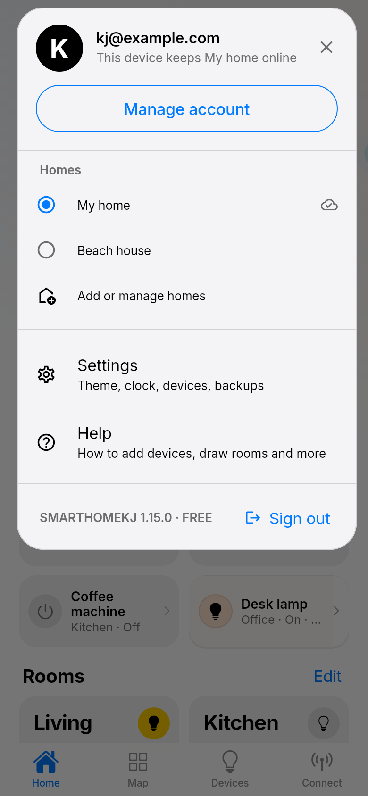 | 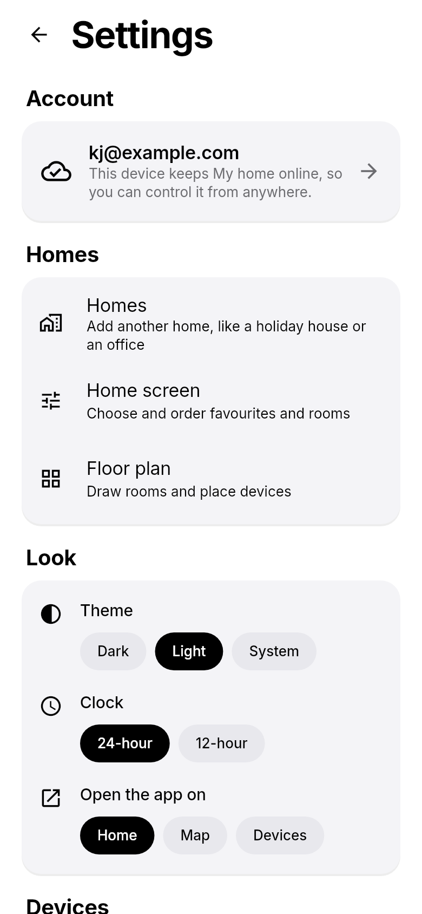 | 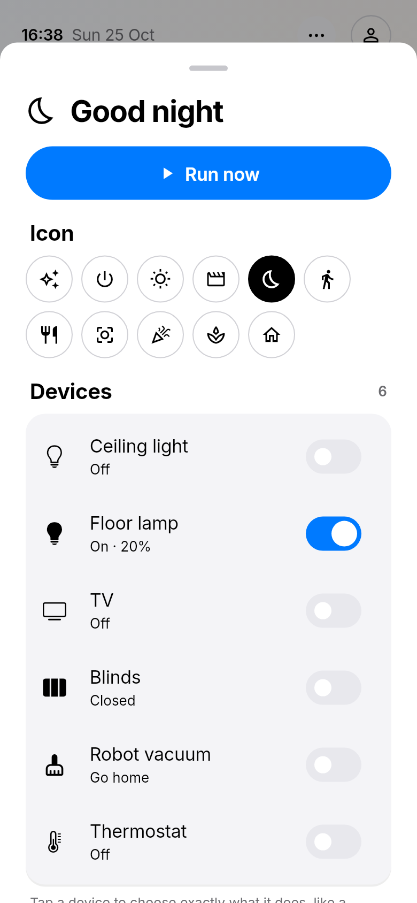 | 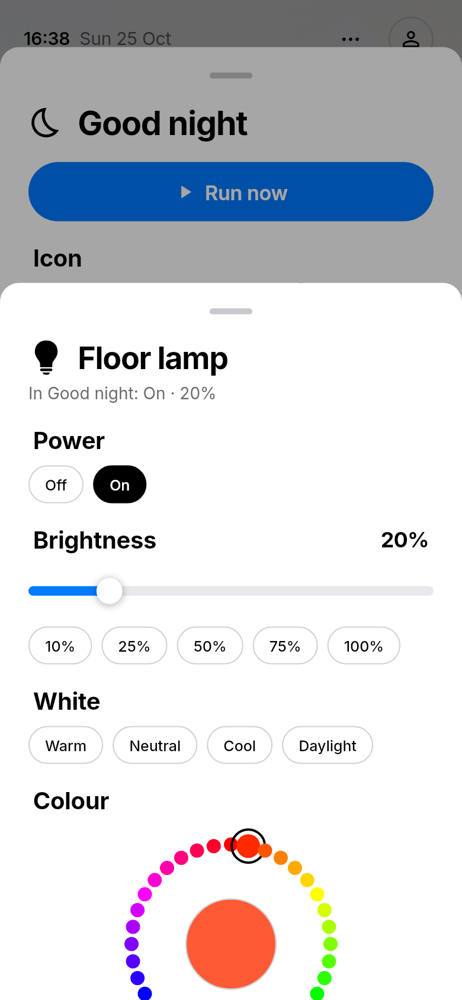 |

| Camera | Camera login | Recordings |
| --- | --- | --- |
| 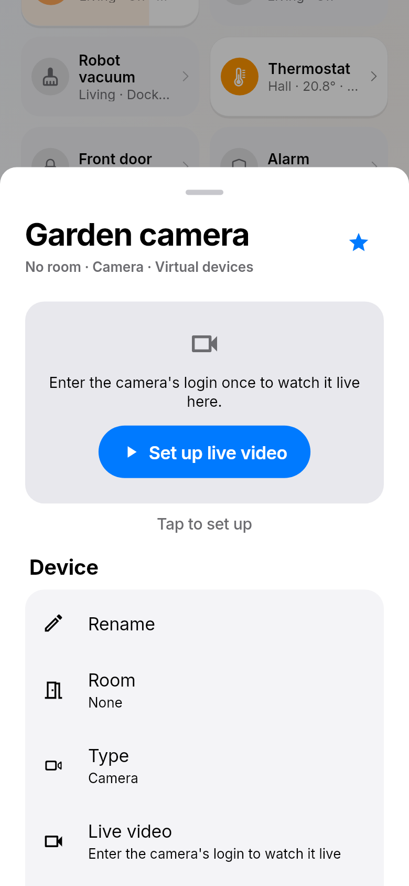 | 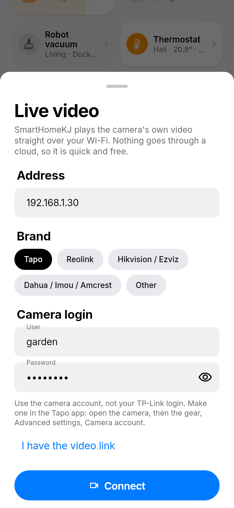 | 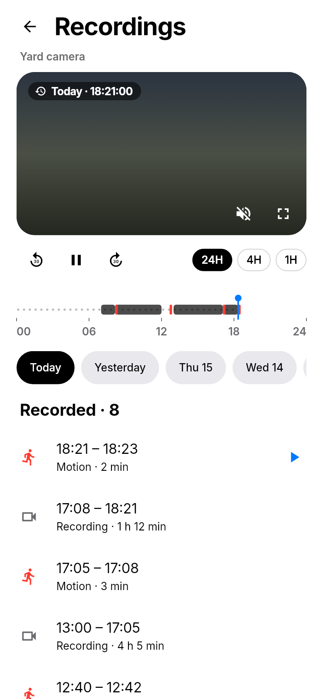 | 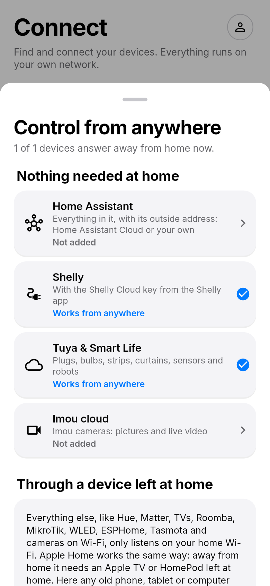 |

| Automations | An automation | Restore on a new install | MikroTik router |
| --- | --- | --- | --- |
| 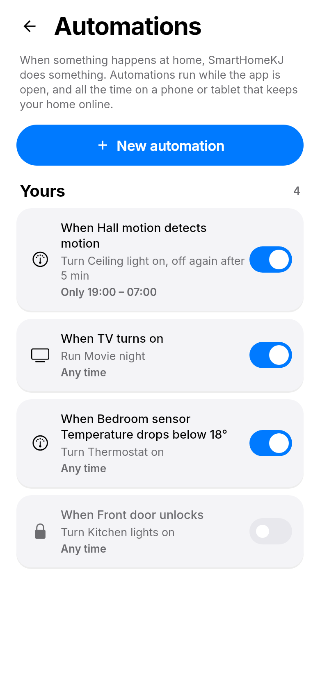 | 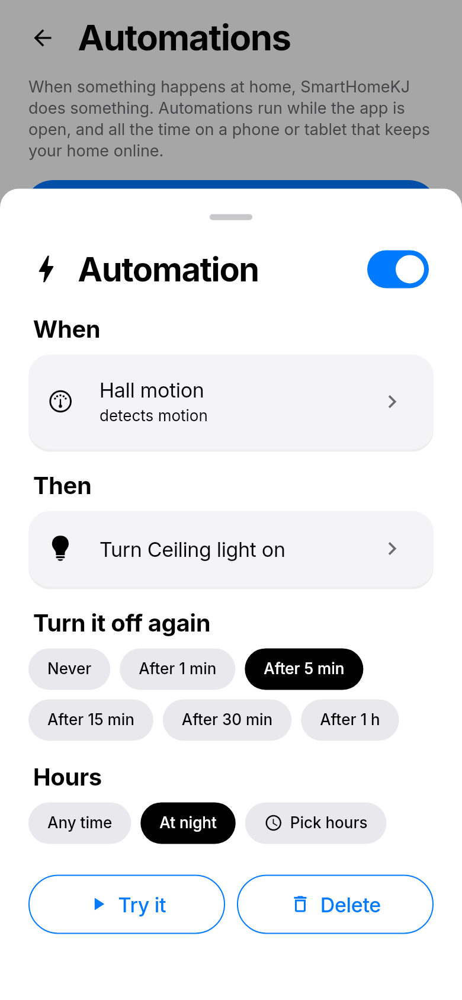 | 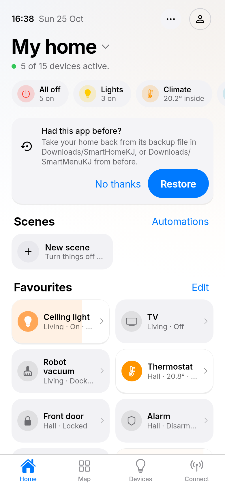 | 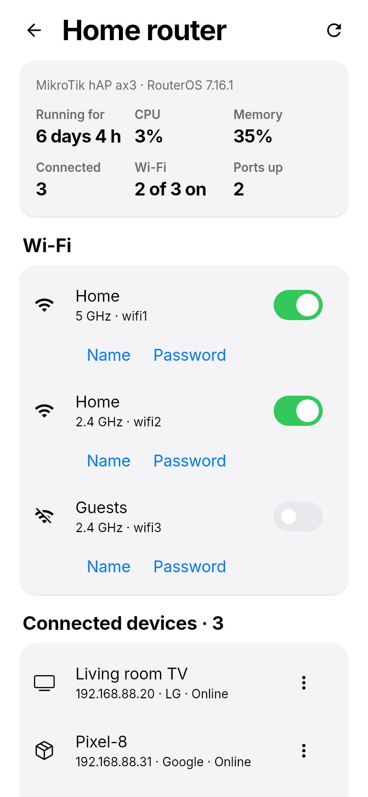 |


## What it does

- **Floor plan.** Add a ready-made room (Kitchen, Bedroom, Garage...) and it drops into a free spot, or draw one by dragging on the dotted grid. Move rooms; resize them from any corner or wall, with two fingers, or one square at a time with + and -; duplicate or delete them, and undo any change. Devices that are not on the plan wait in a tray at the bottom: drag one into a room and it joins that room. Tap a device on the plan to switch it, hold it for full controls, tap a room to open it.
- **Controls.** Sliders with one-tap presets for brightness and white (Warm, Neutral, Cool, Daylight), a colour ring, a thermostat dial with Eco / Comfort / Warm, blinds you slide open, volume, locks that only open when you hold them, and sensor readings, each shown only when the device supports it. Robot vacuums and mowers get start / pause ringed by their battery, send home, stop, find and suction or cleaning mode; washers, dryers and dishwashers show what they are doing and the time left; alarms arm home / away / night and ask before disarming (the code is never saved); purifiers and fans get speed and presets, humidifiers a dial, and valves, sirens, garage doors, buttons and cameras their own controls. Drag sideways across a light's tile to dim it without opening anything.
- **Home screen.** The home's name, the time and a status strip (lights on, temperature inside, locks, open blinds, offline devices) where each pill opens the devices behind it, next to one button that switches everything off. Smoke, carbon monoxide and leaks show first, in red. Then your favourites and your rooms. **Edit home** picks and orders the favourites and rooms.
- **Rooms.** Tap a room on the home screen or the plan to see everything in it: one slider for all its lights, all off / lights on, every device, and a shortcut to edit the room on the plan.
- **Scenes.** Make a scene that turns devices off ("All off", "Good night"), turns them on, or brings back how they are now ("Movie night"), and run it with one tap. Hold a scene to change it: each device has an on / off switch, and tapping a device sets exactly what it does (brightness, white, colour, temperature, blind position, lock, robot, alarm) without touching the device until the scene runs, with **Try it on the device** to check. Scenes can run by themselves at a time of day on chosen weekdays. On Android they run even when the app is closed (an exact alarm wakes it); on computers they run while the app is open.
- **Automations.** "When this happens, do that": a sensor detects motion, a door opens, a room gets warmer than 25°, a light turns on, the alarm goes off, a robot finishes or a device stops answering, and a scene runs or a device switches, maybe off again a few minutes later (a light after motion). An automation can be kept to some hours, like the night. They run while the app is open, and all the time on a device that keeps the home online.
- **Home-screen widget and All off tile (Android).** A black widget with the open home's first four scenes and All off, and an All off tile in Quick Settings. They work with the app closed. **Settings → Shortcuts** adds them.
- **Matter, with no hub.** SmartHomeKJ is its own Matter controller: type a device's pairing code and its lights, plugs, sensors, blinds, locks, thermostat, robot vacuum, washer, dishwasher, air purifier, water valve or smoke alarm appear, controlled directly on your network. Matter bridges (Hue, IKEA, Aqara...) bring all their devices at once.
- **Cameras, live.** **Connect → Add a camera** finds cameras on your Wi-Fi (ONVIF), asks for the camera's own login and works out where its video is: from ONVIF, or the usual addresses of Tapo, Reolink, Hikvision / Ezviz and Dahua / Imou / Amcrest, or a link you type. The video plays straight from the camera over your Wi-Fi, never through a cloud: RTSP in the Android app (HD or the quicker SD picture, sound, full screen with zoom), MJPEG on every device, and Home Assistant cameras on every device too. Elsewhere a camera shows a new picture every few seconds. Ring, Arlo, Nest, Blink and Wyze only stream to their own cloud; add them through Home Assistant.
- **Camera recordings.** Dahua, Imou, Amcrest, Hikvision and Ezviz cameras play back what they recorded on their memory card: **Recordings** under the live video shows a week of days, a line through the day with what was recorded and, in red, when something moved, and the list of clips. Tap a clip or anywhere on the line to watch from then, skip 30 seconds either way, or zoom the line to 4 hours or 1 hour. Recordings play in the Android app on your home Wi-Fi; ones saved to a camera maker's cloud stay in its own app.
- **Scan network.** Finds everything on your Wi-Fi that answers (mDNS, UPnP / SSDP, ONVIF cameras, Kasa, Yeelight and iRobot discovery, and a knock on every address): TVs, speakers, plugs, lights, robots, routers, hubs, printers, phones and more. Everything it finds can be added in one tap, or by typing a device's IP address. Each one is named, not just numbered: from the router's list of who has which address (a MikroTik with its login), the device's own Bonjour or Windows name, DNS or its web page, and its maker from the first half of its MAC address (the IEEE list ships with the app), so "192.168.88.23" reads "Galaxy-S23 · Samsung" or "iPhone or iPad · Apple". Devices without controls of their own show whether they are online, who made them, can be woken with Wake-on-LAN and open their own web page.
- **iRobot Roomba, on your Wi-Fi.** Roombas and Braavas are found by the scan. Hold the robot's HOME button until it plays a tone, tap **Get password**, and it starts, pauses, resumes, goes home and beeps from the app, with its battery, bin and errors, without the iRobot cloud.
- **MikroTik routers.** Add the router and log in with its WinBox user: **Router settings** shows its model, RouterOS version, uptime, CPU and memory, every connected device (add one to your home, or have the router always give it the same address), switches Wi-Fi networks and ports on and off, changes the Wi-Fi name and password, renames and restarts the router, and opens WebFig for every other setting. RouterOS 7 is reached through its REST API, RouterOS 6 through its API on port 8728.
- **TV remote.** Power, volume, mute, channels, arrows, OK, back, home and play / pause for Samsung, LG, Sony and Roku TVs, plus volume and play / pause for Chromecast, Google TV and UPnP speakers. TVs that are fully off are woken with Wake-on-LAN.
- **More than one home.** Tap the home's name at the top of the home screen to switch homes, add one, rename, reorder or delete them. Each home has its own floor plan, devices, connections and scenes.
- **Profile menu.** The round button in the top right of every tab opens your account, a quick switch between homes, **Settings** and **Help**. Settings has the theme, a 24- or 12-hour clock, the tab the app opens on, how often devices are checked, vibration, the widget and Quick Settings tile, backups and the app's licences.
- **Control from anywhere with nothing at home.** Devices with a cloud of their own answer from anywhere by themselves: Shelly once its Shelly Cloud key is added (at home the app still talks to them straight over Wi-Fi, and switches to the cloud on mobile data or when they stop answering), Tuya and Smart Life devices, Imou cameras, and everything in Home Assistant once its outside address is added. **Connect → Control from anywhere** shows which of your devices answer away from home and opens each of these. Everything else only listens on the home Wi-Fi, as in Apple Home, which needs an Apple TV or HomePod at home; for those, see the next point. iRobot, Philips Hue, TP-Link Tapo and Kasa, Google and Apple keep their clouds closed to other apps.
- **Account and control from anywhere (optional, free).** Sign in from the profile button and your homes are saved to your account and stay in step on every device you sign in on. Most devices only answer on your home Wi-Fi, so on mobile data your phone cannot reach them by itself. Leave a second phone, tablet or computer at home with the app, signed in and plugged in, and turn on **Keep … online from this device** there (not on the phone you carry). Your other devices then switch things through it from anywhere, straight away when they are off Wi-Fi; the home screen shows *Away · through …* when they do, and an *Away from home* card saying what is missing when nothing at home is passing commands on. If the Firebase database rules were never set, the account screen says so and copies them for you. On Android it keeps running in the background with a small notification.
- **Backups.** On Android the app keeps a backup file of every home in *Downloads/SmartHomeKJ*, written after each change. The file stays when the app is uninstalled, so after a reinstall the home screen offers to take your homes back from it (or **Settings → Restore from a file**). The file includes your connection passwords; it can be switched off in Settings. On every device you can also copy a home as text and paste it back elsewhere.
- **Light and dark themes**, phone layout with a bottom bar, desktop layout with a side rail.

## Which devices work

No app can speak every protocol on its own, so SmartHomeKJ combines direct local control of the most common open systems with bridges that already cover thousands of brands.

| Connection | What it reaches | How |
| --- | --- | --- |
| **Matter** | Matter lights, plugs, switches, sensors, blinds, thermostats, locks, fans, air purifiers, robot vacuums, washers, dryers, dishwashers, water valves, smoke and CO alarms and air quality sensors, and everything behind a Matter bridge (Hue, IKEA, Aqara, SwitchBot...) | SmartHomeKJ is its own Matter controller: add a device with its pairing code and it is controlled directly on your network. No hub, cloud or account |
| **Home Assistant** | Anything Home Assistant supports: Matter and Thread, Zigbee (ZHA), Z-Wave, Google Nest, Sonos, IKEA, Xiaomi, Tuya, TP-Link, Roborock, Ecovacs, iRobot, thermostats, locks, alarms, cameras, media players and more | Its REST API with a long-lived access token. With its outside address (Home Assistant Cloud or your own) it also answers from anywhere |
| **MQTT & Zigbee2MQTT** | Over 4,000 Zigbee devices through Zigbee2MQTT, plus anything that uses Home Assistant MQTT discovery (Tasmota, ESPHome, Shelly, Valetudo robots, OpenMQTTGateway...), including vacuums, mowers, valves, sirens and buttons, plus any device you describe by topic | Any MQTT broker, live updates |
| **Network devices** | Samsung (Tizen), LG (webOS), Sony Bravia and Roku TVs; Chromecast, Google TV and Nest speakers; UPnP / DLNA TVs, speakers and receivers (Sonos and others); TP-Link Kasa plugs, strips and bulbs; Yeelight; Belkin WeMo; RTSP / ONVIF cameras (Tapo, Reolink, Hikvision, Ezviz, Dahua, Imou, Amcrest and most others); iRobot Roomba and Braava robots; MikroTik routers. Anything else shows as online / offline, opens its web page and can be woken with Wake-on-LAN | Each device's own local protocol. Samsung and LG TVs ask once on screen to allow the app; Sony TVs need a pre-shared key set under IP control; a Roomba hands out its password after its HOME button is held; MikroTik routers take their own login |
| **Valetudo** | Robot vacuums running the cloud-free Valetudo firmware (Roborock, Dreame, Viomi...) | Its local REST API, found by Scan network |
| **Philips Hue** | Hue lights and plugs | The bridge's local API. Press the link button, tap Pair |
| **Shelly** | Gen1, Plus, Pro, Gen3 and Gen4 relays, plugs, dimmers, shutters and H&T sensors | Local HTTP / RPC; with the Shelly Cloud key, the Shelly cloud away from home |
| **Tuya & Smart Life** | Smart Life and Tuya Smart plugs, power strips, bulbs, LED strips, dimmers, curtains, thermostats, heaters, fans, purifiers, robot vacuums and temperature, door, motion, smoke, gas and leak sensors | Tuya's cloud (OpenAPI) with a free cloud project linked to the Smart Life app, from anywhere |
| **Imou cloud** | Imou cameras: online status, pictures and live video (HLS) | The Imou Open Platform with a free developer account on the Imou Life login, from anywhere |
| **Tasmota** | Plugs, bulbs, switches and sensors with Tasmota firmware | Local HTTP commands |
| **WLED** | LED strips and lamps | Local JSON API |
| **ESPHome** | Lights, switches, fans, covers, locks and sensors | The `web_server:` component |
| **Virtual devices** | Placeholders for trying the app or planning before you buy | Built in |

**Matter:** the device has to be on your network already. If it is set up in Google Home, Apple Home, SmartThings or Alexa, open it there and choose *Linked Matter apps* (or *Turn on pairing mode*) to get a new pairing code, then type it in **Connect → Matter** or **Devices → Add device**. It stays in the other app too. Brand-new devices that join Wi-Fi over Bluetooth need to be set up once in another Matter app first; SmartHomeKJ cannot do Bluetooth setup yet.

New device families are added by writing one driver class in `lib/integrations/` and listing it in `lib/integrations/catalog.dart`.

## Getting the app

Builds are made for free by GitHub Actions (`.github/workflows/build.yml`):

- Every push to `main` builds an Android APK, a Windows zip, a Linux tarball and a macOS app, attached to the workflow run under **Artifacts**.
- Pushing a tag such as `v1.0.0`, or running the workflow by hand with a version, also publishes them on the **Releases** page.
- Android builds are signed with the app's own key, which `tool/android_key.py` makes from the `ANDROID_SIGNING_SECRET` repository secret (any text of 16 or more characters), the same key every time. So each version installs over the last one and keeps your home. Without the secret they get a one-off debug key and do not install over other versions.

The macOS app is not signed, so the first time you open it, right-click it and choose Open. iPhone builds need an Apple developer account to sign, so for now build them yourself with Xcode (`flutter build ios`).

### Build it yourself

1. Install [Flutter](https://docs.flutter.dev/get-started/install) (stable channel).
2. `flutter pub get`
3. Run it: `flutter run` (pick a phone, emulator, or `-d windows` / `-d macos` / `-d linux`).

## First steps in the app

1. The app opens with a sample home of virtual devices so you can try everything right away. Delete or move anything you like.
2. Go to **Connect** and tap **Scan network**, or pick a connection and type its address.
3. New devices appear on the **Devices** tab. Open **Map** and tap **Edit**: new devices wait in the tray at the bottom, drag each one into its room.
4. To control your home when you are out, tap the profile button in the top right, then **Sign in or create account**, and on a device that stays at home turn on **Keep … online from this device**.

## For developers

```
lib/
  models/         Device, room, floor and home data (JSON)
  integrations/   One driver per system + catalog + network scan
  state/          HomeStore (all changes go through it), local storage, sample home
  cloud/          Accounts, sync and remote control over Firebase (REST, no SDK)
  theme/          colours and type (Apple Home look)
  ui/             Screens and shared widgets
test/             Model, driver, store and widget tests
tool/             Screenshot generator
firebase/         Database rules and emulator settings
```

- `flutter analyze` and `flutter test` run on every pull request.
- `flutter test tool/screenshots_test.dart --update-goldens` regenerates the screenshots in `docs/screenshots/`.
- `firebase emulators:exec --only auth,database --config firebase/firebase.json "FIREBASE_EMULATOR=1 flutter test test/firebase_emulator_test.dart"` checks accounts, sync and the database rules against the real Firebase emulators.
- `python3 tool/make_icons.py` redraws the app icon for every platform (needs Pillow).

### Accounts (Firebase)

Accounts use a free Firebase project (Spark plan) through its REST APIs: Email/Password sign-in and the Realtime Database. To use your own project, turn those two on, paste `firebase/database.rules.json` under **Realtime Database → Rules**, and build with `--dart-define=FIREBASE_API_KEY=... --dart-define=FIREBASE_DATABASE_URL=https://....firebasedatabase.app`. The rules let each account read and write only the homes it belongs to.

What is stored: the layout of each home (floors, rooms, devices, scenes, and connections with their addresses, tokens and passwords, so your other devices can use them too), its name, which device keeps it online, and while one does, what the devices are doing and the commands sent through it. Alarm codes are never stored.

## Credits and licences

- App code: MIT licence, see `LICENSE`.
- [Inter](https://fonts.google.com/specimen/Inter) font: SIL Open Font License, see `assets/fonts/`.
- Who made a device, from its MAC address: the IEEE registry as packaged by [oui-data](https://github.com/silverwind/oui-data) (BSD-2-Clause, see `assets/mac_vendors-LICENSE.txt`), turned into `assets/mac_vendors.txt.gz` by `tool/mac_vendors.py`.
- SmartHomeKJ is an independent project. It is not affiliated with or endorsed by Philips Hue, Shelly or any other brand named here.
